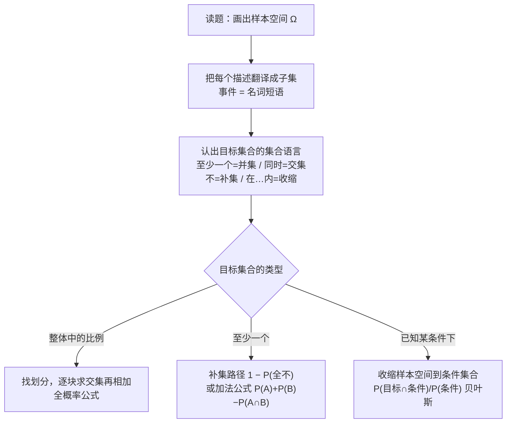

# AP Statistics Probability via Set Operations

> [!abstract] 概述
> 三道 AP 概率题（航班延误 / 疾病检测 / 行李安检）的统一视角：把样本空间 $\Omega$ 上的每个事件看作集合，把题目翻译成**集合运算**——「至少一个」= 并集，「同时」= 交集，「不发生」= 补集，「已知某条件」= 把样本空间**收缩**到该条件集合。所有概率公式（加法公式、全概率公式、贝叶斯公式）都只是集合运算的计数表达。解题顺序：先找集合，再动公式。

## 核心概念：概率 = 集合的测度，公式 = 集合运算

### 样本空间与事件

- **样本空间 $\Omega$**：一次随机试验所有结果的集合（如「随机选一个航班」「随机测一个人」）
- **事件**：$\Omega$ 的子集；$P(A)$ = 集合 $A$ 占 $\Omega$ 的比例
- 题目中的每个名词短语（delayed flights / test positive / triggers alarm）都是一个子集

### 四个基本运算 ↔ 概率语言对照表

| 集合运算 | 符号 | 概率语言 | 三题实例 |
|------|------|------|------|
| 并集 | $A \cup B$ | 至少一个发生（at least one） | 航班：$I \cup M$ |
| 交集 | $A \cap B$ | 同时发生（both / also） | 行李：$F \cap A$ |
| 补集 | $A^c$ | 不发生（not） | 航班：$I^c$ |
| 收缩 | $P(A \mid B)$ | 已知 $B$ 发生时 $A$ 的比例 | 行李：$P(F \mid A)$ |

### 全概率公式 = 用划分切分目标集合

若 $B_1, \dots, B_k$ 是 $\Omega$ 的一个划分（互斥且穷尽），任意目标集合 $T$ 被切成互斥的 $k$ 块：

$$T = (T \cap B_1) \cup (T \cap B_2) \cup \dots \cup (T \cap B_k) \implies P(T) = \sum_i P(T \cap B_i) = \sum_i P(T \mid B_i)\,P(B_i)$$

### 贝叶斯公式 = 收缩样本空间后求占比

已知「落在 $A$ 中」，样本空间从 $\Omega$ **收缩**为 $A$；目标 = 交集 $F \cap A$ 在新空间 $A$ 中的占比：

$$P(F \mid A) = \frac{P(F \cap A)}{P(A)}$$

---

## 1. 航班延误：并集与补集（at least one）

> [!question] 题目
> For flights from a particular airport in January, there is a 30 percent chance of a flight being delayed because of icy weather. If a flight is delayed because of icy weather, there is a 10 percent chance the flight will also be delayed because of a mechanical problem. If a flight is not delayed because of icy weather, there is a 5 percent chance that it will be delayed because of a mechanical problem. If one flight is selected at random from the airport in January, what is the probability that the flight selected will have at least one of the two types of delays?
> (A) 0.065 (B) 0.335 (C) 0.350 (D) 0.450

> [!info] 我的答案: **B (0.335)** — 答对 · 代表性题

### 集合翻译（示意图替代：纯文字题，以集合翻译表替代原图）

| 集合 | 含义 | 概率信息 |
|------|------|------|
| $I$ | 因冰雪延误的航班 | $P(I) = 0.3$ |
| $M$ | 因机械故障延误的航班 | $P(M \mid I) = 0.1$，$P(M \mid I^c) = 0.05$ |
| **目标 $I \cup M$** | 至少一种延误（并集） | 求 $P(I \cup M)$ |

### 解答路径一：补集（推荐）

「至少一个」的补 = 「两个都没有」（德摩根律：$(I \cup M)^c = I^c \cap M^c$）：

$$P(I \cup M) = 1 - P(I^c \cap M^c) = 1 - P(I^c)\,P(M^c \mid I^c) = 1 - 0.7 \times 0.95 = 1 - 0.665 = \mathbf{0.335}$$

### 解答路径二：加法公式（inclusion–exclusion）

$$P(I \cup M) = P(I) + P(M) - P(I \cap M)$$

- $P(I \cap M) = P(M \mid I)\,P(I) = 0.1 \times 0.3 = 0.03$
- $P(M)$ 先用全概率：$P(M) = 0.1 \times 0.3 + 0.05 \times 0.7 = 0.065$
- $P(I \cup M) = 0.3 + 0.065 - 0.03 = \mathbf{0.335}$

> [!warning] 陷阱命名：把条件概率当独立
> 规则：「also be delayed」给出的是 $P(M \mid I)$ 而非 $P(M)$；两类延误不独立（$0.1 \neq 0.05$），禁直接 $1 - (1-0.3)(1-0.05)$。
> 防法：见到 "If …, there is a … chance" 立即写成 $P(\cdot \mid \cdot)$；先定目标集合是并集还是交集，再选补集或加法路径。

### 数值自洽检验

两路径同得 $0.335$；并集不小于任一子集：$P(I \cup M) \ge P(I) = 0.3$ ✓。选项溯源：(A) 0.065 = $P(M)$（全概率值）；(C) 0.350 = $0.3 + 0.05$（无条件乱加）；(D) 0.450 = $0.3 + 0.1 + 0.05$（全加）。

---

## 2. 疾病检测：全概率 = 切分目标集合

> [!question] 题目
> Ninety percent of the people who have a particular disease will have a positive result on a given diagnostic test. Ninety percent of the people who do not have the disease will have a negative result on this test. If 5 percent of a certain population has the disease, what percent of that population would test positive for the disease?
> (A) 4.5% (B) 5% (C) 14% (D) 90%

> [!info] 我的答案: **C (14%)** — 答对 · 代表性题

### 集合翻译（示意图替代：纯文字题，以集合翻译表替代原图）

| 集合 | 含义 | 概率信息 |
|------|------|------|
| $D$ / $D^c$ | 患病者 / 未患病者（$\Omega$ 的划分） | $P(D) = 0.05$ |
| $P \cap D$ | 真阳性块 | $P(P \mid D) = 0.9$ |
| $P \cap D^c$ | 假阳性块 | $P(P \mid D^c) = 1 - P(N \mid D^c) = 0.1$ |
| **目标 $P$** | 整体阳性率 = 真阳性 $\cup$ 假阳性 | 求 $P(P)$ |

### 解答：用划分 $\{D, D^c\}$ 切分 $P$

$$P = (P \cap D) \cup (P \cap D^c) \quad \text{（两块互斥）}$$

- 真阳性块：$P \cap D = P(P \mid D)\,P(D) = 0.9 \times 0.05 = 0.045$
- 假阳性块：$P \cap D^c = P(P \mid D^c)\,P(D^c) = 0.1 \times 0.95 = 0.095$
- $P(P) = 0.045 + 0.095 = \mathbf{0.14 = 14\%}$

### 数值自洽检验

整体比例必介于各条件概率之间：$P(P \mid D^c) = 0.1 \le P(P) \le P(P \mid D) = 0.9$ ✓；且 $P(P)$ 是 $0.1$ 与 $0.9$ 的加权平均，患病率仅 5%，结果应靠近 $0.1$ 一侧，$0.14$ 合理 ✓。选项溯源：(A) 4.5% 只是 $P \cap D$（真阳性块），漏掉假阳性块。

> [!warning] 陷阱命名：只算「真阳性」
> 规则：「what percent of that population would test positive」要的是整个 $P$ = 真阳性 $\cup$ 假阳性；划分 $\{D, D^c\}$ 两块都要。
> 防法：问「整体中某集合的比例」→ 先找题目给的划分（患病/未患病、延误/未延误），逐块求交集再相加，一块都不能少。

---

## 3. 行李安检：条件概率 = 收缩样本空间（贝叶斯）

> [!question] 题目
> All bags entering a research facility are screened. Ninety-seven percent of the bags that contain forbidden material trigger an alarm. Fifteen percent of the bags that do not contain forbidden material also trigger the alarm. If 1 out of every 1,000 bags entering the building contains forbidden material, what is the probability that a bag that triggers the alarm will actually contain forbidden material?
> (A) 0.00097 (B) 0.00640 (C) 0.14550 (D) 0.97000

> [!info] 我的答案: **B (0.00640)** — 答对 · 代表性题

### 集合翻译（示意图替代：纯文字题，以集合翻译表替代原图）

| 集合 | 含义 | 概率信息 |
|------|------|------|
| $F$ / $F^c$ | 含违禁品 / 不含（$\Omega$ 的划分） | $P(F) = 0.001$ |
| $A$ | 触发警报的行李 | $P(A \mid F) = 0.97$，$P(A \mid F^c) = 0.15$ |
| **目标 $P(F \mid A)$** | 收缩样本空间到 $A$ 后，$F \cap A$ 的占比 | 求 $P(F \mid A)$ |

### 解答：贝叶斯 = 收缩后求占比

分子 = 目标交集：

$$P(F \cap A) = P(A \mid F)\,P(F) = 0.97 \times 0.001 = 0.00097$$

分母 = 新样本空间 $A$ 的总量（对 $\{F, F^c\}$ 用全概率切分）：

$$P(A) = P(A \mid F)\,P(F) + P(A \mid F^c)\,P(F^c) = 0.00097 + 0.15 \times 0.999 = 0.00097 + 0.14985 = 0.15082$$

$$P(F \mid A) = \frac{0.00097}{0.15082} \approx 0.00643 \approx \mathbf{0.00640}$$

### 数值自洽检验

频率直觉：每 1000 件行李 ≈ 1 件真违禁（触发 0.97 件）+ $999 \times 0.15 \approx 150$ 件假阳性，警报中真违禁占比 $\approx \frac{0.97}{0.97 + 149.85} \approx 0.0064$ ✓；比值 $\le 1$ ✓；必小于 $P(A \mid F) = 0.97$（分母被假阳性稀释）✓。选项溯源：(D) 0.97 把条件方向读反；(A) 0.00097 是交集 $P(F \cap A)$ 而非条件概率；(C) 0.14550 = $0.97 \times 0.15$（两条件概率直接相乘的干扰）。

> [!warning] 陷阱命名：条件方向读反（逆概率混淆）
> 规则：$P(A \mid F) = 0.97$（有违禁 → 警报）$\neq P(F \mid A)$（警报 → 有违禁）；当分母集合极小（1/1000）时，假阳性淹没真阳性，两个方向差两个数量级。
> 防法：把问题改写成「在 ___ 的集合内，___ 占多少」——"a bag that triggers the alarm" 说明分母是 $A$ 不是 $\Omega$；先算 $P(A)$，再除。

---

## 三题对照：集合运算总表

| 题 | 目标集合 | 已知结构 | 核心运算 | 公式 |
|------|------|------|------|------|
| 航班 | $I \cup M$（至少一个） | $P(I)$，$P(M \mid I)$，$P(M \mid I^c)$ | 并集 / 补集 / 加法 | $1 - P(I^c \cap M^c)$ |
| 疾病 | $P$ 整体 | 划分 $\{D, D^c\}$ + 条件概率 | 切分求和（全概率） | $\sum_i P(P \cap D_i)$ |
| 行李 | $F$ 在 $A$ 内的占比 | $P(F)$，$P(A \mid F)$，$P(A \mid F^c)$ | 收缩样本空间（贝叶斯） | $P(F \cap A)/P(A)$ |

## 解题决策树（集合论三步法）

## 相关链接

- [[AP_Statistics_Charts]]
- [[Two-Way_Tables]]
- [[AP_Statistics_Relative_Frequency]] — 条件频率 vs 边际频率（同一「收缩」思想）
- [[AP_Statistics_MOC]]

> [!summary] 一句话收束
> 概率题 = 集合题：翻译事件为子集，认出「并 / 交 / 补 / 收缩」四运算——全概率是切分，贝叶斯是收缩，加法公式是并集计数；先找集合，再动公式。
