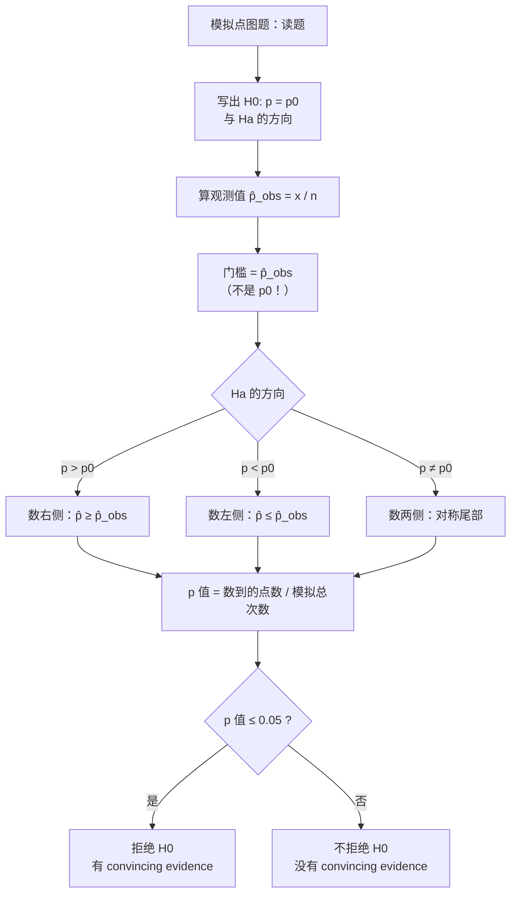

# AP Statistics Simulated P-value from a Dotplot

> [!abstract] 概述
> 用**模拟**估计 p 值：把「总体真实比例 = 原假设值 $p_0$」当作已知世界，重复抽 $n$ 个样本，把每个样本的 $\hat p$ 画成点图；**p 值 = 落在观测值 $\hat p_{\mathrm{obs}}$ 及其「更极端」一侧的点占全部模拟的比例**。本题的难点不在算术而在**门槛选谁**——用原假设的 $6\%$ 当门槛得 $47\%$，用观测到的 $8\%$ 当门槛得 $29\%$。只有后者才是 p 值。

## 0. 方法骨架：从点图读 p 值

### 三步法

| 步 | 动作 | 本题 |
|---|---|---|
| ① 定观测值 | $\hat p_{\mathrm{obs}} = x/n$ | $6/75 = 8\%$ |
| ② 定门槛 | 由 $H_a$ 的方向决定，**门槛 $= \hat p_{\mathrm{obs}}$** | $H_a: p > 6\%$，故门槛 $8\%$ |
| ③ 数点 | $\text{p 值} = \dfrac{\#\{\text{模拟 } \hat p \ge \hat p_{\mathrm{obs}}\}}{\text{模拟总次数}}$ | $29/100 = 0.29$ |

### 方向决定「更极端」是哪一侧

| $H_a$ | 更极端的一侧 | 数哪些点 |
|---|---|---|
| $p > p_0$ | 右侧（更大） | $\hat p \ge \hat p_{\mathrm{obs}}$ |
| $p < p_0$ | 左侧（更小） | $\hat p \le \hat p_{\mathrm{obs}}$ |
| $p \ne p_0$ | 两侧 | 满足 $\lvert \hat p - p_0 \rvert \ge \lvert \hat p_{\mathrm{obs}} - p_0 \rvert$ 的点 |

### 判定

p 值 $\le \alpha$（AP 常用 $\alpha = 0.05$）$\Rightarrow$ 拒绝 $H_0$，有 convincing evidence；否则不拒绝，**没有** convincing evidence。

> [!warning] 「没有证据」$\ne$「证明了 $H_0$」
> 不拒绝只说明观测值可以用抽样波动解释，不能断言真实比例就等于 $6\%$。

### 模拟点图的两个结构特征

1. **横坐标只取离散值**：每个模拟样本的 $\hat p = k/75$，故点只落在 $1/75 = 1.33\%$ 的整数倍上（$1.33\%,\,2.67\%,\,4.00\%,\,5.33\%,\,6.67\%,\,8.00\%,\,9.33\%,\,10.67\%,\dots$），**不会落在 $1\%$ 网格的每个刻度上**。本题观测值 $8\% = 6/75$ 恰好落在一个点上。
2. **点图以 $p_0$ 为中心**：模拟世界的真实比例就是 $6\%$，所以点图重心在 $6\%$ 附近；观测值 $8\%$ 落在重心右侧但仍在主体之内——这就是「不显著」的直观来源。

## 1. 迟到率：模拟点图上的 p 值（答案 D）

> [!question] 题目
> **6.** Attendance records at a large high school show that 6 percent of students are late to school on a typical day. The students in an AP Statistics class believe the rate is higher than 6 percent. The students took a simple random sample of 75 students from the school and asked, "Were you late to school today?" In their sample, 6 out of the 75 students, or 8 percent of the sample, said they were late to school that day. The AP Statistics students conducted a simulation with 100 samples of 75 students from a population where 6 percent of students are late. The results of the simulation are shown in the dotplot.
>
> Based on the simulation and the results of the AP Statistics class's sample, is there convincing statistical evidence that more than 6 percent of all students at the school are late to school on a typical day?
>
> (A) Yes, because about 47% of the simulated sample percentages of students late to school are 6% or more.
> (B) No, because about 47% of the simulated sample percentages of students late to school are 6% or more.
> (C) Yes, because about 29% of the simulated sample percentages of students late to school are 8% or more.
> (D) No, because about 29% of the simulated sample percentages of students late to school are 8% or more.

![[simulated_dotplot_late_students_20261027.png]]

> [!info] 我的答案: 未记录（本次由截图直接核对） | 正确答案: **D**
> 关键：p 值 $= 29\%$ 很大，观测到的 $8\%$ 完全落在抽样波动范围内。

### 读图：逐列清点（合计 100 点）

| 模拟样本百分比 | $1.33\%$ | $2.67\%$ | $4.00\%$ | $5.33\%$ | $6.67\%$ | $\mathbf{8.00\%}$ | $9.33\%$ | $10.67\%$ |
|---|---|---|---|---|---|---|---|---|
| 频数 | 4 | 14 | 13 | 22 | 18 | **17** | **10** | **2** |

$0\%$（$0/75$）与 $12\%$（$9/75$）两列在本轮模拟中为空。

清点自检：八列之和 $4+14+13+22+18+17+10+2 = 100$，与「100 次模拟」吻合——点数对不上说明读图漏列，必须重数。

### 解答

**第 1 步：写出假设。**

$$H_0: p = 0.06, \qquad H_a: p > 0.06$$

其中 $p$ = 全校学生中某天迟到的真实比例。

**第 2 步：定观测值与门槛。**

$$\hat p_{\mathrm{obs}} = \frac{6}{75} = 0.08 = 8\%$$

$H_a$ 是「大于」，故 p 值要从 $8\%$ 往右数（**不是**从 $6\%$ 往右数）。

**第 3 步：数点。**

$$\#\{\hat p \ge 8\%\} = 17\ (8.00\%) + 10\ (9.33\%) + 2\ (10.67\%) = 29$$

$$\text{p 值} = \frac{29}{100} = 0.29$$

**第 4 步：结论。**

$0.29 \gg 0.05$，p 值不小，不拒绝 $H_0$。**没有**令人信服的统计证据表明全校迟到率高于 $6\%$。

### 数值自洽检验（独立第二把尺）

模拟只是抽样的经验近似，回代精确二项分布验证：$X \sim \mathrm{Bin}(75,\,0.06)$。

$$\mathrm{P}(X \ge 6) = 1 - \sum_{k=0}^{5}\binom{75}{k}(0.06)^k(0.94)^{75-k} = 0.2943 \approx 29\%$$

$$\mathrm{P}(X \ge 5) = 0.4708 \approx 47\%$$

两个选项里的数字 $29\%$ 与 $47\%$ 同时被精确理论复现，说明：

- $29\%$ 对应门槛 $X \ge 6$，即 $\hat p \ge 8\%$ —— 这才是 **p 值**；
- $47\%$ 对应门槛 $X \ge 5$，即 $\hat p \ge 6.67\%$，也就是题面口语化的「$6\%$ or more」。

第三个独立核验（量纲）：$\hat p$ 的标准误

$$\sigma_{\hat p} = \sqrt{\frac{p_0(1-p_0)}{n}} = \sqrt{\frac{0.06 \times 0.94}{75}} = 0.0274$$

观测值偏离 $p_0$ 的距离

$$z = \frac{0.08 - 0.06}{0.0274} = 0.73$$

$z$ 不到 $1$ 个标准差——右侧面积自然在 $0.2$ 量级（正态近似 $1 - \Phi(0.73) = 0.233$，二项精确值 $0.294$，量级一致）✓。三条独立路径（点图数点 / 二项精确 / 正态近似）都指向「不显著」。

### 四个选项为什么这样设计：$2 \times 2$ 干扰矩阵

本题选项是「结论 $\times$ 数字」的完全交叉，专治两种**互相独立**的错误：

| 选项 | 数字来源 | 结论 | 诊断 |
|---|---|---|---|
| (A) | $\ge 6\% \Rightarrow 47\%$ | Yes | 门槛错 **+** 结论反 |
| (B) | $\ge 6\% \Rightarrow 47\%$ | No | **门槛错**（$6\%$ 是 $p_0$，不是观测值） |
| (C) | $\ge 8\% \Rightarrow 29\%$ | Yes | 门槛对，**结论反**（p 值大却说有证据） |
| **(D)** | $\ge 8\% \Rightarrow 29\%$ | No | ✓ |

> [!warning] 陷阱命名：p 值门槛错位（拿 $p_0$ 当 $\hat p_{\mathrm{obs}}$）
> 规则：p 值的门槛永远是**观测到的统计量** $\hat p_{\mathrm{obs}} = 8\%$，绝不是原假设值 $p_0 = 6\%$。用 $p_0$ 当门槛，等于在数「有多大比例的模拟值大于总体中心」——对任何近似对称的分布这都是 $50\%$ 上下，与「这次观测有多异常」毫无关系。
> 防法：读题后先单独写一行「门槛 $= \hat p_{\mathrm{obs}} = 8\%$」再动笔数点；同时用「$H_a$ 是大于 / 小于 / 不等于」决定往哪一侧数。

> [!warning] 配套陷阱：把「p 值大」读成「有证据」
> 规则：p 值大 $\Rightarrow$ 观测值在 $H_0$ 下很常见 $\Rightarrow$ **没有**证据；p 值小 $\Rightarrow$ 罕见 $\Rightarrow$ 有证据。方向与「数值大小」的直觉相反。
> 防法：下结论前把 p 值翻译成一句白话——「如果真实比例就是 $6\%$，那么每 100 次抽样里约有 29 次会看到 $8\%$ 或更高」。这句话念完，结论自然出来。

## 解题决策树

## 与相关知识点对照

| 概念 | 本题位置 | 易混点 |
|---|---|---|
| 抽样分布 $\sigma_{\hat p} = \sqrt{p_0(1-p_0)/n}$ | 自洽检验 | 标准误用 $p_0$ 而非 $\hat p$ |
| 二项分布 $\mathrm{Bin}(n, p_0)$ | 精确复算 p 值 | 模拟只是它的经验版本 |
| 显著性检验的结论语言 | 第 4 步 | 「没有证据」$\ne$「证明 $H_0$ 成立」 |
| 点图（dotplot） | 载体 | 只看形状不够，必须**数点** |

## 相关链接

- [[Significance_Tests_Proportions]] — 单比例显著性检验的完整流程（假设 / 条件 / 统计量 / 结论四步）
- [[Sampling_Distribution_Proportions]] — $\hat p$ 的抽样分布与标准误
- [[Binomial_and_Geometric_Distributions]] — 本题精确复算 p 值所用的二项分布
- [[Unit_6_Inference_for_Proportions]] — 比例的统计推断单元总览
- [[Type_I_and_II_Errors]] — 「不拒绝」与「接受」的区别
- [[AP_Statistics_Charts]] — 点图作为单变量定量数据的展示工具
- [[AP_Statistics_MOC]] — AP 统计学知识地图

> [!summary] 一句话收束
> 模拟点图求 p 值 = **以观测值 $\hat p_{\mathrm{obs}}$ 为门槛**，数「$H_a$ 方向上至少同样极端」的点占全部模拟的比例；本题 $29/100 = 0.29$ 不小，故无证据支持「高于 $6\%$」——拿 $p_0 = 6\%$ 当门槛得 $47\%$，是本题唯一的坑。
